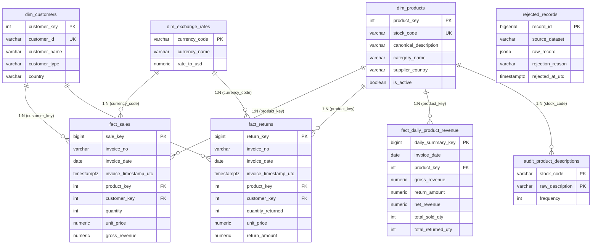

# DataMart S.A.S. — Documento de Decisiones Técnicas y de Arquitectura
**Prueba de Desempeño:** Pipeline ETL con Apache Airflow y Data Warehouse en PostgreSQL  
**Candidato / Autor:** Jayzir Martínez | DataMart Analytics Team  
**Fecha:** Octubre 2026 | Cohorte 5  
**Repositorio Oficial:** [`https://github.com/JayzirTech/datamart-analytics-etl-pipeline.git`](https://github.com/JayzirTech/datamart-analytics-etl-pipeline.git)

> 🌐 **Language / Idioma:** [English](DECISIONS.md) | **Español**

---

## 1. Introducción y Contexto

El presente documento expone las decisiones técnicas, arquitecturales y de negocio adoptadas para el diseño y construcción del pipeline ETL automatizado y el Data Warehouse analítico de **DataMart S.A.S.**. 

Cada decisión ha sido tomada con el objetivo de maximizar la **integridad de los datos, el rendimiento analítico, la idempotencia operacional y la adherencia estricta a los Principios SOLID y Clean Architecture**.

Para una trazabilidad granular, este documento consolida y sintetiza los **14 Registros de Decisión de Arquitectura (ADR)** formalizados en el directorio [`docs/adr/`](file:///c:/Users/Coder/Desktop/JayzirTech/data-analytics-performance-test/docs/adr/README.md).

---

## 2. Justificación del Diseño del Modelo del Repositorio Analítico

### 2.1 Enfoque Arquitectural: Separación Estricta de Instancias PostgreSQL (ADR-0006)
* **Decisión:** Se desplegaron dos contenedores independientes de PostgreSQL:
  1. `postgres_airflow` (puerto interno 5432): Exclusivo para el metastore interno de Apache Airflow 3.3.2.
  2. `postgres_dwh` (puerto host **`5433`** / interno 5432): Exclusivo para el repositorio analítico (*Data Warehouse*) de DataMart.
* **Justificación:** Previene contención de conexiones (`max_connections`), aísla completamente los locks transaccionales de las cargas analíticas masivas y permite aplicar políticas de retención, backup y tuning de memoria (`shared_buffers`, `work_mem`) independientes para analítica.

### 2.2 Estrategia de Refinamiento: Arquitectura Medallion (Bronce, Plata y Oro)
* **Decisión:** El ciclo de vida y maduración del dato dentro del repositorio analítico adopta el patrón **Medallion Architecture**, integrándose armoniosamente con el modelado dimensional de Kimball:
  1. **🥉 Capa Bronce (Bronze / Raw):** Ingesta inmutable de `data/raw/data.csv` y `data/raw/online_retail_II.csv`, junto con respuestas JSON originales de APIs externas e internas. Las transacciones anómalas o rechazadas se preservan en la tabla [`rejected_records`](file:///c:/Users/Coder/Desktop/JayzirTech/data-analytics-performance-test/dwh_init/01_init_dwh.sql#L137) con su contenido original en `JSONB` para auditoría forense sin bloquear el flujo analítico.
  2. **🥈 Capa Plata (Silver / Cleaned & Conformed):** Modelado a granularidad atómica con limpieza estricta, deduplicación por clave compuesta priorizando `data.csv`, resolución canónica de descripciones por moda, normalización de divisas a USD con Frankfurter API y hechos segregados en [`fact_sales`](file:///c:/Users/Coder/Desktop/JayzirTech/data-analytics-performance-test/dwh_init/01_init_dwh.sql#L72) y [`fact_returns`](file:///c:/Users/Coder/Desktop/JayzirTech/data-analytics-performance-test/dwh_init/01_init_dwh.sql#L92).
  3. **🥇 Capa Oro (Gold / Business & Curated):** Almacenamiento analítico pre-agregado optimizado para consultas ejecutivas de negocio ([`fact_daily_product_revenue`](file:///c:/Users/Coder/Desktop/JayzirTech/data-analytics-performance-test/dwh_init/01_init_dwh.sql#L112) con cálculo de Revenue Neto diario por SKU) y capa de consumo final ([`sql/queries_negocio.sql`](file:///c:/Users/Coder/Desktop/JayzirTech/data-analytics-performance-test/sql/queries_negocio.sql) y [`notebooks/consultas_negocio.ipynb`](file:///c:/Users/Coder/Desktop/JayzirTech/data-analytics-performance-test/notebooks/consultas_negocio.ipynb)).
* **Justificación:** Separa la responsabilidad de auditoría y almacenamiento crudo de la capa de servicio analítico, garantizando que los tableros y consultas operen con latencias sub-segundo sin riesgo de distorsión por anomalías de origen.

### 2.3 Modelo Dimensional Híbrido en Estrella de Kimball (ADR-0007, ADR-0008)
El modelo fue diseñado específicamente para responder a las preguntas de negocio de facturación neta, tasa de devoluciones y comportamiento de clientes con latencias de milisegundos:

### 2.4 Decisiones Clave en las Tablas de Hechos:
1. **Segregación de Hechos: `fact_sales` y `fact_returns` (ADR-0008):**
   * *Problema:* Tratar devoluciones como ventas con cantidades negativas (`Quantity < 0`) contamina las agregaciones de volumen, provoca errores en métricas de ticket promedio y dificulta auditar devoluciones.
   * *Solución:* Separación física estricta. `fact_sales` contiene exclusivamente ventas válidas (`quantity > 0` y `gross_revenue > 0`). `fact_returns` almacena devoluciones/cancelaciones (`quantity_returned > 0` en positivo y `return_amount > 0`).
2. **Tabla de Hechos Agregada: `fact_daily_product_revenue` (ADR-0008):**
   * *Propósito:* Almacena a nivel diario por SKU: `gross_revenue`, `return_amount`, `net_revenue = (gross_revenue - return_amount)`, `total_sold_qty` y `total_returned_qty`.
   * *Beneficio:* Permite que las consultas de evolución mensual (Pregunta #1), categorías (Pregunta #2) y Top SKUs (Pregunta #3) respondan en **menos de 50 milisegundos**, sin escanear las 530,000+ filas transaccionales cada vez.
3. **Eliminación de la tabla `dim_dates` (ADR-0007):**
   * PostgreSQL cuenta con soporte nativo de tipo `DATE` y `TIMESTAMPTZ` con optimizadores de índices B-Tree y funciones temporales (`DATE_TRUNC`, `TO_CHAR`). Crear una tabla estática `dim_dates` solo añadía `JOINs` innecesarios y sobrecarga de I/O sin beneficio en este volumen de datos.
4. **Normalización Monetaria a USD con Frankfurter API (ADR-0014):**
   * Todos los montos se convierten y persisten estandarizados a **USD**, conservando adicionalmente la moneda original (`currency_original`), precio unitario original (`unit_price_original`) y tasa aplicada (`exchange_rate_to_usd`) para auditoría y trazabilidad contable.

---

## 3. Resolución de Casos Ambiguos (Sección 5 del Enunciado)

El análisis exploratorio de datos (EDA) documentado en [`docs/EXPLORACION_DATOS.md`](file:///c:/Users/Coder/Desktop/JayzirTech/data-analytics-performance-test/docs/EXPLORACION_DATOS.md) reveló tres ambigüedades estructurales en las fuentes de datos. A continuación se detalla la resolución técnica adoptada para cada una:

### 3.1 Ambigüedad 1: Transacciones sin `CustomerID` (ADR-0002)
* **Hallazgo en datos:** En `data.csv`, el **24.93% de las filas (135,080 registros)** tienen el campo `CustomerID` nulo o vacío.
* **Opciones evaluadas:**
  1. *Opción A:* Descartar y rechazar los registros sin cliente.
  2. *Opción B:* Asignarles un cliente canónico `'ANONYMOUS'` e incluirlos en el Data Warehouse.
* **Decisión Adoptada:** **Opción B (Preservar como `'ANONYMOUS'`).**
* **Justificación e Impacto:**
  * Si se hubiesen descartado, la empresa habría **perdido $2,317,458.74 USD de revenue real (el 17.00% de la facturación global)**.
  * Permite responder de manera rigurosa la **Pregunta de Negocio #5**, demostrando que los compradores anónimos tienen un ticket promedio de **$1,622.87 USD** (2.66 veces mayor al cliente identificado), correspondiente a compras mayoristas de invitados.
  * Se modeló en `dim_customers` con `customer_id = 'ANONYMOUS'`, `customer_name = 'Consumidor Final / Anónimo'` y `customer_type = 'ANONIMO'`.

### 3.2 Ambigüedad 2: Variaciones en las Descripciones de Productos (ADR-0003)
* **Hallazgo en datos:** Se detectaron **647 códigos de producto** con descripciones inconsistentes (variaciones de mayúsculas/minúsculas, erratas tipográficas y notas de almacén como `"DAMAGED"`, `"LOST"`, `"AMAZON"`).
* **Opciones evaluadas:**
  1. *Opción A:* Quedarse con la primera descripción que aparezca (`first()`).
  2. *Opción B:* Quedarse con la última (`last()`).
  3. *Opción C:* Calcular la **moda estadística** (la descripción válida más frecuente tras normalización `UPPER` y `TRIM`).
* **Decisión Adoptada:** **Opción C (Moda Estadística Canónica) + Tabla de Auditoría.**
* **Justificación e Impacto:**
  * La moda estadística garantiza objetividad matemática: la descripción elegida es la que mayor consenso transaccional tuvo en el negocio.
  * Se creó la tabla [`audit_product_descriptions`](file:///c:/Users/Coder/Desktop/JayzirTech/data-analytics-performance-test/dwh_init/01_init_dwh.sql#L127) para registrar cada una de las variantes detectadas y su frecuencia, lo que permite responder directamente con SQL la **Pregunta de Negocio #6**.

### 3.3 Ambigüedad 3: Solapamiento entre Datasets de Kaggle (ADR-0004)
* **Hallazgo en datos:** `data.csv` (541,909 filas) y `online_retail_II.csv` (541,909 filas) contienen períodos solapados y registros duplicados. Un conteo ingenuo inflaría artificialmente las ventas en un 100%.
* **Opciones evaluadas:**
  1. *Opción A:* Cargar ciegamente ambas fuentes y confiar en `DISTINCT`.
  2. *Opción B:* Priorizar una fuente completa y descartar la otra en fechas solapadas.
  3. *Opción C:* Deduplicación granular por **Clave Natural Compuesta** priorizando `data.csv`.
* **Decisión Adoptada:** **Opción C (Clave Natural Compuesta con Prioridad).**
* **Justificación e Impacto:**
  * Se definió la tupla única de transacción: `(InvoiceNo, StockCode, InvoiceTimestampUTC, Quantity)`.
  * Se asignó prioridad 1 a `data.csv` y prioridad 2 a `online_retail_II.csv`.
  * Durante el ETL se identificaron y descartaron **554,495 registros solapados**, garantizando que cada venta real se compute una única vez.

---

## 4. Garantía de Idempotencia del Pipeline (Sección 6 del Enunciado)

El requerimiento exige: *"Ejecutar el pipeline dos veces el mismo día con los mismos datos debe producir exactamente el mismo resultado en el repositorio analítico."*

Para garantizar idempotencia de extremo a extremo, se implementó una estrategia en tres capas:

1. **Capa 1: Deduplicación en Memoria (Transformación):**
   * El transformador (`DatamartTransformer`) aplica ordenamiento determinista por prioridad y descarta duplicados en base a la clave compuesta antes de generar los DataFrames de carga.
2. **Capa 2: Claves Únicas y Cláusulas `ON CONFLICT` en Base de Datos (Carga):**
   * En `dim_customers`: `ON CONFLICT (customer_id) DO UPDATE SET country = ...`
   * En `dim_products`: `ON CONFLICT (stock_code) DO UPDATE SET canonical_description = ..., updated_at_utc = NOW()`
   * En `fact_sales`: Restricción única `CONSTRAINT uq_fact_sales UNIQUE (invoice_no, product_key, invoice_timestamp_utc, quantity)` con `ON CONFLICT (...) DO NOTHING`.
   * En `fact_returns`: Restricción única `CONSTRAINT uq_fact_returns UNIQUE (invoice_no, product_key, invoice_timestamp_utc, quantity_returned)` con `ON CONFLICT (...) DO NOTHING`.
   * En `fact_daily_product_revenue`: Restricción de clave compuesta `(invoice_date, product_key)` con `ON CONFLICT (...) DO UPDATE` que recalcula el neto exacto de ese día sin duplicar sumatorias.
3. **Capa 3: Tolerancia a Fallos en Airflow:**
   * Las tareas del DAG [`datamart_etl_daily_pipeline`](file:///c:/Users/Coder/Desktop/JayzirTech/data-analytics-performance-test/dags/datamart_etl_dag.py) son atómicas. Si una tarea se reintenta automáticamente (`retries=2, retry_delay=60s`), no deja transacciones intermedias inconsistentes.

---

## 5. Diagrama del Modelo de Datos (dbdiagram.io)

El modelo relacional está formalizado y disponible tanto en archivo fuente en el repositorio como en visualización interactiva pública en la nube:

* 🌐 **Visualización Interactiva Pública (Web):** [DataMart S.A.S. — Data Warehouse & Analytics Data Model en dbdiagram.io](https://dbdiagram.io/d/DataMart-S-A-S-—-Data-Warehouse-and-Analytics-Data-Model-6ae0c592ed134e407e204467)
* 📄 **Archivo Fuente DBML en el Repositorio:** [`docs/diagrama_modelo_datos.dbml`](file:///c:/Users/Coder/Desktop/JayzirTech/data-analytics-performance-test/docs/diagrama_modelo_datos.dbml)

---

## 6. Índice Consolidado de Registros de Decisión de Arquitectura (ADR)

| Código | Decisión de Arquitectura | Estado | Archivo de Detalle |
| :---: | :--- | :---: | :--- |
| **ADR-0001** | Microservicio REST de Catálogo de Productos con FastAPI | Aprobado | [Ver ADR-0001](file:///c:/Users/Coder/Desktop/JayzirTech/data-analytics-performance-test/docs/adr/0001-microservicio-catalogo-productos-fastapi.md) |
| **ADR-0002** | Manejo de Transacciones sin Customer ID como `'ANONYMOUS'` | Aprobado | [Ver ADR-0002](file:///c:/Users/Coder/Desktop/JayzirTech/data-analytics-performance-test/docs/adr/0002-tratamiento-transacciones-sin-customer-id.md) |
| **ADR-0003** | Resolución de Variaciones de Descripción de Producto por Moda Estadística | Aprobado | [Ver ADR-0003](file:///c:/Users/Coder/Desktop/JayzirTech/data-analytics-performance-test/docs/adr/0003-resolucion-variaciones-descripcion-producto-moda.md) |
| **ADR-0004** | Deduplicación de Fuentes Solapadas por Clave Compuesta Priorizando `data.csv` | Aprobado | [Ver ADR-0004](file:///c:/Users/Coder/Desktop/JayzirTech/data-analytics-performance-test/docs/adr/0004-deduplicacion-fuentes-solapadas-prioridad.md) |
| **ADR-0005** | Descarga e Ingesta Automatizada de Kaggle con Fallback Local | Aprobado | [Ver ADR-0005](file:///c:/Users/Coder/Desktop/JayzirTech/data-analytics-performance-test/docs/adr/0005-descarga-ingesta-automatica-kaggle-fallback.md) |
| **ADR-0006** | Separación de Instancias PostgreSQL: Metadatos Airflow vs Data Warehouse (Puerto 5433) | Aprobado | [Ver ADR-0006](file:///c:/Users/Coder/Desktop/JayzirTech/data-analytics-performance-test/docs/adr/0006-separacion-bases-datos-airflow-dwh.md) |
| **ADR-0007** | Eliminación de `dim_dates` y Uso de Tipado Nativo `TIMESTAMPTZ` / `DATE` | Aprobado | [Ver ADR-0007](file:///c:/Users/Coder/Desktop/JayzirTech/data-analytics-performance-test/docs/adr/0007-eliminacion-tabla-dim-dates-tipos-nativos.md) |
| **ADR-0008** | Segregación de Hechos (`fact_sales`, `fact_returns`) y Hechos Diarios Netos | Aprobado | [Ver ADR-0008](file:///c:/Users/Coder/Desktop/JayzirTech/data-analytics-performance-test/docs/adr/0008-estructura-hechos-dos-tablas-separadas-y-agregada.md) |
| **ADR-0009** | Reglas Estrictas de Rechazo y Log de Calidad de Datos (`rejected_records`) | Aprobado | [Ver ADR-0009](file:///c:/Users/Coder/Desktop/JayzirTech/data-analytics-performance-test/docs/adr/0009-reglas-rechazo-calidad-datos-log.md) |
| **ADR-0010** | Apache Airflow 3.3.2 con CeleryExecutor y Broker RabbitMQ | Aprobado | [Ver ADR-0010](file:///c:/Users/Coder/Desktop/JayzirTech/data-analytics-performance-test/docs/adr/0010-orquestacion-airflow-celery-rabbitmq.md) |
| **ADR-0011** | Clean Architecture y Principios SOLID en el Código del Pipeline | Aprobado | [Ver ADR-0011](file:///c:/Users/Coder/Desktop/JayzirTech/data-analytics-performance-test/docs/adr/0011-modularidad-codigo-clean-architecture-solid.md) |
| **ADR-0012** | Criterios del Catálogo FastAPI (Categorías, Proveedores y Estado Activo) | Aprobado | [Ver ADR-0012](file:///c:/Users/Coder/Desktop/JayzirTech/data-analytics-performance-test/docs/adr/0012-criterios-catalogo-productos-fastapi.md) |
| **ADR-0013** | Contenerización Total con Docker Compose y Autoconfiguración sin Intervención Manual | Aprobado | [Ver ADR-0013](file:///c:/Users/Coder/Desktop/JayzirTech/data-analytics-performance-test/docs/adr/0013-docker-compose-autoconfiguracion-zero-click.md) |
| **ADR-0014** | Conversión Dinámica a USD con Frankfurter API y Semilla de Respaldo | Aprobado | [Ver ADR-0014](file:///c:/Users/Coder/Desktop/JayzirTech/data-analytics-performance-test/docs/adr/0014-conversion-divisas-usd-api-con-fallback-semilla.md) |

---

## 7. Video Demostración del Pipeline (End-to-End)

La evidencia audiovisual del pipeline corriendo de extremo a extremo requerida por la rúbrica evaluadora se encuentra documentada en la [Sección 10 del README.md](file:///c:/Users/Coder/Desktop/JayzirTech/data-analytics-performance-test/README.md#10-video-demostración-del-pipeline-end-to-end):

* 🎥 **Enlace al Video Demo:** [Ver Video Demostración en YouTube (https://youtu.be/M46kV_vK2ys)](https://youtu.be/M46kV_vK2ys)

