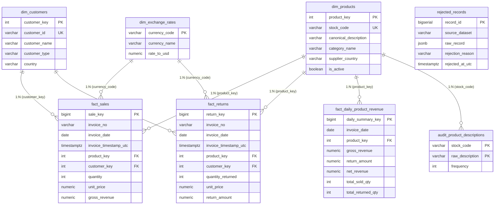

# DataMart S.A.S. — Technical and Architectural Decisions Document
**Performance Test:** ETL Pipeline with Apache Airflow & PostgreSQL Data Warehouse  
**Candidate / Author:** Jayzir Martínez | DataMart Analytics Team  
**Date:** October 2026 | Cohort 5  
**Official Repository:** [`https://github.com/JayzirTech/datamart-analytics-etl-pipeline.git`](https://github.com/JayzirTech/datamart-analytics-etl-pipeline.git)

> 🌐 **Language / Idioma:** **English** | [Español](DECISIONES.md)

---

## 1. Introduction and Context

This document outlines the technical, architectural, and business decisions adopted for the design and construction of the automated ETL pipeline and analytical Data Warehouse for **DataMart S.A.S.**.

Every architectural decision was made to maximize **data integrity, analytical query performance, operational idempotency, and strict adherence to SOLID Principles and Clean Architecture**.

For granular traceability, this document consolidates and synthesizes the **14 Architecture Decision Records (ADRs)** formalized in the [`docs/adr/`](file:///c:/Users/Coder/Desktop/JayzirTech/data-analytics-performance-test/docs/adr/README.md) directory.

---

## 2. Analytical Repository Design Justification

### 2.1 Architectural Approach: Strict Separation of PostgreSQL Instances (ADR-0006)
* **Decision:** Two independent PostgreSQL containers are deployed:
  1. `postgres_airflow` (internal port 5432): Dedicated exclusively to the Apache Airflow 3.3.2 metadata metastore.
  2. `postgres_dwh` (host port **`5433`** / internal port 5432): Dedicated exclusively to the DataMart analytical repository (*Data Warehouse*).
* **Justification:** Prevents connection pool contention (`max_connections`), completely isolates transactional Airflow locks from bulk analytical ETL loads, and allows independent memory tuning (`shared_buffers`, `work_mem`) and retention policies for analytics.

### 2.2 Refinement Strategy: Medallion Architecture (Bronze, Silver & Gold)
* **Decision:** The data refinement lifecycle strictly follows the **Medallion Architecture**, working in tandem with the Kimball dimensional model:
  1. **🥉 Bronze Layer (Raw):** Immutable ingestion of `data/raw/data.csv` and `data/raw/online_retail_II.csv`, along with raw JSON API responses. Rejected records are preserved in [`rejected_records`](file:///c:/Users/Coder/Desktop/JayzirTech/data-analytics-performance-test/dwh_init/01_init_dwh.sql#L137) in raw `JSONB` format for forensic auditing without halting the pipeline.
  2. **🥈 Silver Layer (Cleaned & Conformed):** Atomic granularity modeling with strict validation, composite key deduplication prioritizing `data.csv`, canonical mode description resolution, USD currency standardization, and segregated facts in [`fact_sales`](file:///c:/Users/Coder/Desktop/JayzirTech/data-analytics-performance-test/dwh_init/01_init_dwh.sql#L72) and [`fact_returns`](file:///c:/Users/Coder/Desktop/JayzirTech/data-analytics-performance-test/dwh_init/01_init_dwh.sql#L92).
  3. **🥇 Gold Layer (Business & Curated):** Pre-aggregated high-speed analytical storage ([`fact_daily_product_revenue`](file:///c:/Users/Coder/Desktop/JayzirTech/data-analytics-performance-test/dwh_init/01_init_dwh.sql#L112) with daily net revenue per SKU) and the final consumption layer ([`sql/queries_negocio.sql`](file:///c:/Users/Coder/Desktop/JayzirTech/data-analytics-performance-test/sql/queries_negocio.sql) and [`notebooks/consultas_negocio.ipynb`](file:///c:/Users/Coder/Desktop/JayzirTech/data-analytics-performance-test/notebooks/consultas_negocio.ipynb)).
* **Justificación:** Decouples raw auditing storage from analytical serving, guaranteeing sub-second dashboard performance without distortion from upstream data anomalies.

### 2.3 Kimball Hybrid Star Schema Dimensional Model (ADR-0007, ADR-0008)
The schema was engineered specifically to answer business questions regarding net billing, return rates, and customer behavior with sub-second latencies:

### 2.4 Key Decisions in Fact Tables:
1. **Fact Segregation: `fact_sales` and `fact_returns` (ADR-0008):**
   * *Problem:* Treating returns as negative sales (`Quantity < 0`) corrupts volume aggregations, distorts average order values (AOV), and complicates audit trails.
   * *Solution:* Physical segregation. `fact_sales` contains only valid sales transactions (`quantity > 0` and `gross_revenue > 0`). `fact_returns` stores cancellations and returns (`quantity_returned > 0` and `return_amount > 0`).
2. **Aggregated Daily Fact Table: `fact_daily_product_revenue` (ADR-0008):**
   * *Purpose:* Pre-computes metrics daily by SKU: `gross_revenue`, `return_amount`, `net_revenue = (gross_revenue - return_amount)`, `total_sold_qty`, and `total_returned_qty`.
   * *Benefit:* Enables monthly trend queries (Question #1), category analysis (Question #2), and Top SKUs (Question #3) to respond in **under 50 milliseconds**, avoiding full table scans over 530,000+ transactional rows.
3. **Omission of `dim_dates` (ADR-0007):**
   * PostgreSQL provides native `DATE` and `TIMESTAMPTZ` types with optimized B-Tree indexing and date functions (`DATE_TRUNC`, `TO_CHAR`). An explicit static date dimension would add unnecessary JOIN overhead with zero performance benefit for this data volume.
4. **Monetary Normalization to USD via Frankfurter API (ADR-0014):**
   * All revenue amounts are standardized and persisted in **USD**, while also preserving original currency (`currency_original`), original unit price (`unit_price_original`), and exchange rate (`exchange_rate_to_usd`) for accounting auditability.

---

## 3. Resolution of Ambiguous Cases (Section 5)

Exploratory Data Analysis (EDA) in [`docs/EXPLORACION_DATOS.md`](file:///c:/Users/Coder/Desktop/JayzirTech/data-analytics-performance-test/docs/EXPLORACION_DATOS.md) identified three core structural ambiguities in the source datasets. Below are the technical resolutions implemented:

### 3.1 Ambiguity 1: Transactions without `CustomerID` (ADR-0002)
* **Data Finding:** In `data.csv`, **24.93% of rows (135,080 records)** have null or empty customer identifiers.
* **Evaluated Options:**
  1. *Option A:* Reject and discard transactions lacking customer IDs.
  2. *Option B:* Assign canonical customer `'ANONYMOUS'` and retain them in the Data Warehouse.
* **Adopted Decision:** **Option B (Retain as `'ANONYMOUS'`).**
* **Justification & Business Impact:**
  * Discarding them would cause the loss of **$2,317,458.74 USD in real revenue (17.00% of total revenue)**.
  * Allows answering **Business Question #5**, proving that anonymous guest buyers have an average ticket of **$1,622.87 USD** (2.66 times higher than registered customers), reflecting guest B2B wholesale purchases.
  * Modeled in `dim_customers` with `customer_id = 'ANONYMOUS'`, `customer_name = 'Guest / Anonymous Consumer'`, and `customer_type = 'ANONIMO'`.

### 3.2 Ambiguity 2: Variations in Product Descriptions (ADR-0003)
* **Data Finding:** Detected **647 product codes** with conflicting descriptions (casing variations, warehouse notes like `"DAMAGED"`, `"LOST"`, `"AMAZON"`).
* **Evaluated Options:**
  1. *Option A:* Keep first encountered description (`first()`).
  2. *Option B:* Keep last encountered description (`last()`).
  3. *Option C:* Calculate the **statistical mode** (most frequent valid description after `UPPER` and `TRIM` normalization).
* **Adopted Decision:** **Option C (Canonical Statistical Mode) + Audit Table.**
* **Justification & Business Impact:**
  * Mathematical mode ensures deterministic consensus: the chosen description reflects true transactional majority.
  * Created audit table [`audit_product_descriptions`](file:///c:/Users/Coder/Desktop/JayzirTech/data-analytics-performance-test/dwh_init/01_init_dwh.sql#L127) logging all variants and frequencies, directly answering **Business Question #6**.

### 3.3 Ambiguity 3: Overlap between Kaggle Datasets (ADR-0004)
* **Data Finding:** `data.csv` and `online_retail_II.csv` contain overlapping timeframes and duplicate transactions. Naive ingestion would double sales figures.
* **Evaluated Options:**
  1. *Option A:* Load both blindly and rely on generic `DISTINCT`.
  2. *Option B:* Discard entire second source on overlapping dates.
  3. *Option C:* Granular deduplication by **Composite Natural Key** prioritizing `data.csv`.
* **Adopted Decision:** **Option C (Composite Natural Key with Priority).**
* **Justification & Business Impact:**
  * Defined unique transactional tuple: `(InvoiceNo, StockCode, InvoiceTimestampUTC, Quantity)`.
  * Assigned Priority 1 to `data.csv` and Priority 2 to `online_retail_II.csv`.
  * The pipeline detected and eliminated **554,495 overlapping records**, guaranteeing each real transaction is counted exactly once.

---

## 4. Pipeline Idempotency Guarantee (Section 6)

Requirement: *"Executing the pipeline twice on the same day with the same data must yield the exact same result in the analytical repository."*

A 3-layer idempotency strategy was engineered:

1. **Layer 1: In-Memory Deduplication (Transformation Stage):**
   * `DatamartTransformer` applies deterministic sorting and eliminates duplicates based on composite keys before generating database payload DataFrames.
2. **Layer 2: Unique Constraints and `ON CONFLICT` Clauses (Loading Stage):**
   * In `dim_customers`: `ON CONFLICT (customer_id) DO UPDATE SET country = ...`
   * In `dim_products`: `ON CONFLICT (stock_code) DO UPDATE SET canonical_description = ..., updated_at_utc = NOW()`
   * In `fact_sales`: Unique constraint `uq_fact_sales (invoice_no, product_key, invoice_timestamp_utc, quantity)` with `ON CONFLICT DO NOTHING`.
   * In `fact_returns`: Unique constraint `uq_fact_returns (invoice_no, product_key, invoice_timestamp_utc, quantity_returned)` with `ON CONFLICT DO NOTHING`.
   * In `fact_daily_product_revenue`: Composite key constraint `(invoice_date, product_key)` with `ON CONFLICT DO UPDATE` to recalculate exact net revenue without double-counting.
3. **Layer 3: Fault Tolerance in Airflow:**
   * DAG tasks in [`datamart_etl_daily_pipeline`](file:///c:/Users/Coder/Desktop/JayzirTech/data-analytics-performance-test/dags/datamart_etl_dag.py) are atomic. Task retries (`retries=2, retry_delay=60s`) leave no partial or corrupt intermediate states.

---

## 5. Data Model Diagram (dbdiagram.io)

The relational schema is formalized both as repository source code and as an interactive cloud diagram:

* 🌐 **Public Cloud Interactive Visualization:** [DataMart S.A.S. — Data Warehouse & Analytics Data Model on dbdiagram.io](https://dbdiagram.io/d/DataMart-S-A-S-—-Data-Warehouse-and-Analytics-Data-Model-6ae0c592ed134e407e204467)
* 📄 **DBML Source Code File:** [`docs/diagrama_modelo_datos.dbml`](file:///c:/Users/Coder/Desktop/JayzirTech/data-analytics-performance-test/docs/diagrama_modelo_datos.dbml)

---

## 6. Consolidated Architecture Decision Records (ADR) Index

| Code | Architecture Decision | Status | Detail Document |
| :---: | :--- | :---: | :--- |
| **ADR-0001** | Product Catalog REST Microservice with FastAPI | Approved | [View ADR-0001](file:///c:/Users/Coder/Desktop/JayzirTech/data-analytics-performance-test/docs/adr/0001-microservicio-catalogo-productos-fastapi.md) |
| **ADR-0002** | Handling Transactions without Customer ID as `'ANONYMOUS'` | Approved | [View ADR-0002](file:///c:/Users/Coder/Desktop/JayzirTech/data-analytics-performance-test/docs/adr/0002-tratamiento-transacciones-sin-customer-id.md) |
| **ADR-0003** | Product Description Variation Resolution via Statistical Mode | Approved | [View ADR-0003](file:///c:/Users/Coder/Desktop/JayzirTech/data-analytics-performance-test/docs/adr/0003-resolucion-variaciones-descripcion-producto-moda.md) |
| **ADR-0004** | Composite Key Deduplication with Priority to `data.csv` | Approved | [View ADR-0004](file:///c:/Users/Coder/Desktop/JayzirTech/data-analytics-performance-test/docs/adr/0004-deduplicacion-fuentes-solapadas-prioridad.md) |
| **ADR-0005** | Automated Kaggle Download with Local Fallback | Approved | [View ADR-0005](file:///c:/Users/Coder/Desktop/JayzirTech/data-analytics-performance-test/docs/adr/0005-descarga-ingesta-automatica-kaggle-fallback.md) |
| **ADR-0006** | Database Separation: Airflow Metastore vs Data Warehouse (Port 5433) | Approved | [View ADR-0006](file:///c:/Users/Coder/Desktop/JayzirTech/data-analytics-performance-test/docs/adr/0006-separacion-bases-datos-airflow-dwh.md) |
| **ADR-0007** | Omission of `dim_dates` in Favor of Native `TIMESTAMPTZ` / `DATE` | Approved | [View ADR-0007](file:///c:/Users/Coder/Desktop/JayzirTech/data-analytics-performance-test/docs/adr/0007-eliminacion-tabla-dim-dates-tipos-nativos.md) |
| **ADR-0008** | Segregated Facts (`fact_sales`, `fact_returns`) and Daily Net Fact Table | Approved | [View ADR-0008](file:///c:/Users/Coder/Desktop/JayzirTech/data-analytics-performance-test/docs/adr/0008-estructura-hechos-dos-tablas-separadas-y-agregada.md) |
| **ADR-0009** | Strict Rejection Quality Rules and Audit Log (`rejected_records`) | Approved | [View ADR-0009](file:///c:/Users/Coder/Desktop/JayzirTech/data-analytics-performance-test/docs/adr/0009-reglas-rechazo-calidad-datos-log.md) |
| **ADR-0010** | Apache Airflow 3.3.2 with CeleryExecutor and RabbitMQ Broker | Approved | [View ADR-0010](file:///c:/Users/Coder/Desktop/JayzirTech/data-analytics-performance-test/docs/adr/0010-orquestacion-airflow-celery-rabbitmq.md) |
| **ADR-0011** | Clean Architecture and SOLID Principles in Pipeline Code | Approved | [View ADR-0011](file:///c:/Users/Coder/Desktop/JayzirTech/data-analytics-performance-test/docs/adr/0011-modularidad-codigo-clean-architecture-solid.md) |
| **ADR-0012** | FastAPI Catalog Criteria (Categories, Suppliers, Active Status) | Approved | [View ADR-0012](file:///c:/Users/Coder/Desktop/JayzirTech/data-analytics-performance-test/docs/adr/0012-criterios-catalogo-productos-fastapi.md) |
| **ADR-0013** | Full Containerization with Zero-Manual Intervention Docker Compose | Approved | [View ADR-0013](file:///c:/Users/Coder/Desktop/JayzirTech/data-analytics-performance-test/docs/adr/0013-docker-compose-autoconfiguracion-zero-click.md) |
| **ADR-0014** | Dynamic Currency Conversion to USD via Frankfurter API with Seed Fallback | Approved | [View ADR-0014](file:///c:/Users/Coder/Desktop/JayzirTech/data-analytics-performance-test/docs/adr/0014-conversion-divisas-usd-api-con-fallback-semilla.md) |

---

## 7. End-to-End Pipeline Video Demonstration

Audiovisual evidence of the pipeline executing end-to-end is documented in [Section 10 of README.md](file:///c:/Users/Coder/Desktop/JayzirTech/data-analytics-performance-test/README.md#10-end-to-end-pipeline-video-demonstration):

* 🎥 **Video Demo Link:** [Watch Video Demonstration on YouTube (https://youtu.be/M46kV_vK2ys)](https://youtu.be/M46kV_vK2ys)
