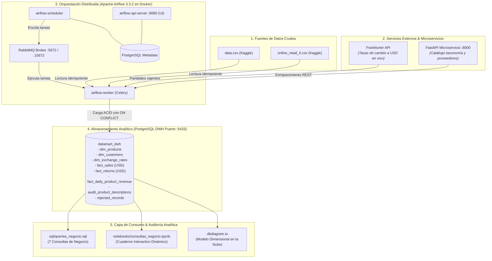
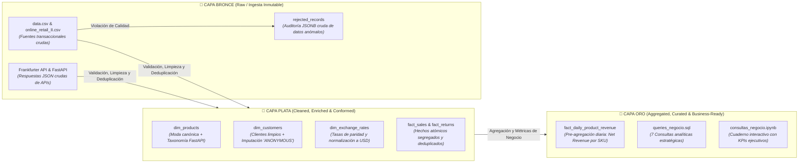
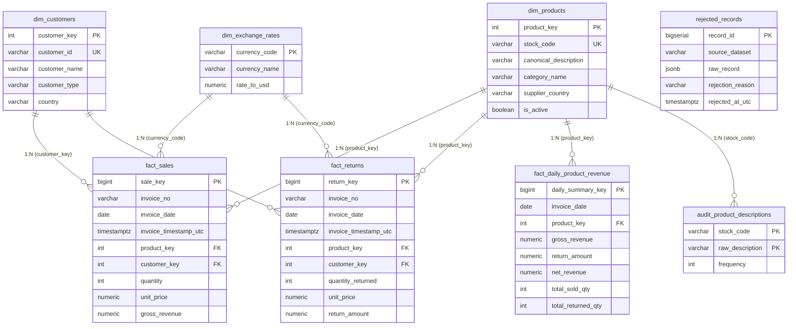
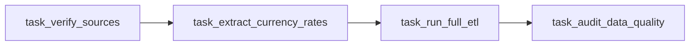

# DataMart S.A.S. — Pipeline ETL Analítico y Data Warehouse
**Prueba de Desempeño:** Pipeline ETL con Apache Airflow, FastAPI y Data Warehouse en PostgreSQL  
**Autor:** Jayzir Martínez | DataMart Analytics Team  
**Cohorte:** Riwi Cohorte 5 | Octubre 2026  
**Repositorio Oficial:** [`https://github.com/JayzirTech/datamart-analytics-etl-pipeline.git`](https://github.com/JayzirTech/datamart-analytics-etl-pipeline.git)

> 🌐 **Language / Idioma:** [English](README.md) | **Español**

---

## 1. Visión General de la Solución

Solución de ingeniería de datos integral, modular y 100% contenerizada para **DataMart S.A.S.** que automatiza la ingesta masiva de transacciones de retail e-commerce (+1,000,000 de registros), enriquece los productos en tiempo real mediante un microservicio REST en **FastAPI**, estandariza las divisas a USD consumiendo **Frankfurter API**, valida la calidad de datos con políticas de rechazo estrictas y puebla un **Data Warehouse en PostgreSQL** mediante un modelo dimensional en estrella optimizado para consultas analíticas sub-segundo.



### 1.1 Arquitectura de Datos: Patrón Medallion (Bronce, Plata y Oro)

El procesamiento y refinamiento de los datos implementa el patrón **Medallion Architecture**, garantizando que cada registro transaccional transite por etapas de ingesta inmutable, estandarización atómica conformada y curaduría de negocio analítica:



* **🥉 Capa Bronce (Raw):** Preserva las fuentes en bruto tal como fueron recibidas (`data/raw/*.csv`, respuestas REST originales) y almacena registros anómalos en [`rejected_records`](file:///c:/Users/Coder/Desktop/JayzirTech/data-analytics-performance-test/dwh_init/01_init_dwh.sql#L137) con formato `JSONB` original para auditoría forense sin pérdida de información.
* **🥈 Capa Plata (Cleaned & Conformed):** Aplica validación estricta de calidad, deduplicación por clave natural compuesta priorizando `data.csv`, enriquecimiento con el catálogo FastAPI, estandarización de divisas a USD con Frankfurter API y estructuración en dimensiones conformadas y hechos atómicos segregados (`fact_sales` y `fact_returns`).
* **🥇 Capa Oro (Business / Analytics-Ready):** Almacena las tablas agregadas de alto rendimiento como [`fact_daily_product_revenue`](file:///c:/Users/Coder/Desktop/JayzirTech/data-analytics-performance-test/dwh_init/01_init_dwh.sql#L112) (revenue neto diario por SKU) y expone la capa de consumo analítico ([`sql/queries_negocio.sql`](file:///c:/Users/Coder/Desktop/JayzirTech/data-analytics-performance-test/sql/queries_negocio.sql) y [`notebooks/consultas_negocio.ipynb`](file:///c:/Users/Coder/Desktop/JayzirTech/data-analytics-performance-test/notebooks/consultas_negocio.ipynb)) con respuestas sub-segundo para la gerencia.

### 1.2 Diagrama Entidad-Relación del Data Warehouse (Modelo Dimensional en Estrella de Kimball)



> 📌 **Modelo en dbdiagram.io:**
> * 🌐 **Visualización Interactiva Pública (Web):** [DataMart S.A.S. — Data Warehouse & Analytics Data Model](https://dbdiagram.io/d/DataMart-S-A-S-—-Data-Warehouse-and-Analytics-Data-Model-6ae0c592ed134e407e204467)
> * 📄 **Archivo Fuente DBML:** [`docs/diagrama_modelo_datos.dbml`](file:///c:/Users/Coder/Desktop/JayzirTech/data-analytics-performance-test/docs/diagrama_modelo_datos.dbml)
> * 📑 **Detalle en Decisiones Técnicas:** [Sección 5 de DECISIONES.md](file:///c:/Users/Coder/Desktop/JayzirTech/data-analytics-performance-test/DECISIONES.md#5-diagrama-del-modelo-de-datos-dbdiagramio)

---

## 2. Pila Tecnológica

| Componente | Tecnología | Versión / Puerto | Función |
| :--- | :--- | :--- | :--- |
| **Orquestador** | Apache Airflow | `3.3.2` (`:8080`) | Planificación, reintentos y orquestación del DAG diario |
| **Broker de Mensajes** | RabbitMQ | `3-management-alpine` (`:15672` / `:5672`) | Broker distribuido para CeleryExecutor |
| **Microservicio Catálogo** | FastAPI + Uvicorn | Python 3.11 (`:8000`) | Taxonomía, proveedor y estado activo/descontinuado |
| **API de Divisas** | Frankfurter API | REST (`api.frankfurter.dev`) | Tasas de cambio en vivo hacia USD con fallback semilla local |
| **Data Warehouse** | PostgreSQL | `15-alpine` (`:5433`) | Almacén analítico dimensional y hechos segregados |
| **Metastore Airflow** | PostgreSQL | `15-alpine` (Interno `5432`) | Base de datos de estado y metadatos de Airflow |
| **Contenedores** | Docker & Docker Compose | v2+ | Despliegue automatizado sin intervención manual |
| **Calidad y ETL** | Python / Pandas / Psycopg2 | 3.13 | Clean Architecture, SOLID e Idempotencia con UPSERTs |

---

## 3. Guía de Despliegue Rápido (< 10 Minutos)

El entorno cuenta con **autoconfiguración total (*Zero-Manual Intervention*)**: al levantar los contenedores con Docker Compose, el servicio `airflow-init` crea automáticamente la base de datos, ejecuta las migraciones, registra al usuario administrador, configura la conexión de PostgreSQL DWH y establece todas las variables operativas en Airflow.

### Paso 1: Clonar el Repositorio
```bash
git clone https://github.com/JayzirTech/datamart-analytics-etl-pipeline.git
cd datamart-analytics-etl-pipeline
```

### Paso 2: Crear el Archivo de Variables de Entorno
Copia la plantilla preconfigurada `.env.example` a `.env`:
```bash
# En Windows PowerShell:
Copy-Item .env.example .env

# En Linux / macOS / Bash:
cp .env.example .env
```

*(Las credenciales y puertos por defecto ya vienen listos para funcionar sin requerir modificaciones adicionales).*

### Paso 3: Levantar los Contenedores
Ejecuta Docker Compose para compilar e iniciar los 8 servicios en segundo plano:
```bash
docker compose up -d
```

### Paso 4: Verificar el Estado de los Servicios
Verifica que todos los contenedores estén activos y saludables:
```bash
docker compose ps
```

Deberás observar los siguientes contenedores activos:
* `datamart_airflow_webserver` — `Up` (`http://localhost:8080`)
* `datamart_airflow_scheduler` — `Up`
* `datamart_airflow_worker` — `Up`
* `datamart_airflow_dag_processor` — `Up`
* `datamart_fastapi_products` — `Up (healthy)` (`http://localhost:8000`)
* `datamart_postgres_dwh` — `Up (healthy)` (Puerto `5433`)
* `datamart_postgres_airflow` — `Up (healthy)`
* `datamart_rabbitmq` — `Up (healthy)` (`http://localhost:15672`)
* `datamart_airflow_init` — `Exited (0)` *(normal, finalizó exitosamente la inicialización)*

---

## 4. Validación de Connections y Variables en Airflow

Para certificar que la autoconfiguración del pipeline se ejecutó correctamente sin intervención humana, ejecuta las siguientes comprobaciones:

### 4.1 Validar la Conexión hacia el Data Warehouse (`postgres_dwh_conn`)
```bash
docker exec datamart_airflow_scheduler airflow connections get postgres_dwh_conn
```
> **Salida esperada:**
> ```text
> conn_type: postgres
> host: postgres_dwh
> port: 5432
> schema: datamart_dwh
> login: dwh_user
> ```

### 4.2 Validar las Variables Operativas de Airflow
```bash
docker exec datamart_airflow_scheduler airflow variables list
```
> **Salida esperada:**
> ```text
> key                  
> ====================
> PIPELINE_ENVIRONMENT
> RAW_DATA_PATH       
> FRANKFURTER_API_URL 
> FASTAPI_BASE_URL    
> ```

---

## 5. Accesos y Credenciales de Servicios

| Servicio | URL Local | Usuario | Contraseña |
| :--- | :--- | :--- | :--- |
| **Airflow Web UI** | [http://localhost:8080](http://localhost:8080) | `admin` | `admin` |
| **FastAPI Swagger Docs** | [http://localhost:8000/docs](http://localhost:8000/docs) | N/A | N/A |
| **RabbitMQ Management** | [http://localhost:15672](http://localhost:15672) | `airflow_broker` | `broker_secret_password` |
| **PostgreSQL Data Warehouse** | `localhost:5433` / DB: `datamart_dwh` | `dwh_user` | `dwh_secret_password` |

---

## 6. Ejecución del Pipeline ETL en Airflow

El DAG **`datamart_etl_daily_pipeline`** está configurado con schedule diario y reintentos automáticos (`retries=2, retry_delay=60s`).

### Disparar el Pipeline Manualmente:
1. **Desde la Web UI:** Ingresa a [http://localhost:8080](http://localhost:8080), localiza `datamart_etl_daily_pipeline` y pulsa el botón **Trigger DAG (▶)**.
2. **Desde la Consola CLI:**
   ```bash
   docker exec datamart_airflow_scheduler airflow dags trigger datamart_etl_daily_pipeline
   ```

### Fases de Ejecución del DAG:


1. **`task_verify_sources`:** Valida la presencia de `data.csv` y `online_retail_II.csv` en `data/raw/`.
2. **`task_extract_currency_rates`:** Consulta en vivo **Frankfurter API** (`https://api.frankfurter.dev/v1/latest?base=USD`) y sincroniza 29 tasas de cambio vigentes en `dim_exchange_rates`.
3. **`task_run_full_etl`:**
   * Aplica reglas de limpieza y validación de calidad.
   * Asigna `'ANONYMOUS'` a clientes nulos (ADR-0002).
   * Deduplica por clave natural compuesta con prioridad a `data.csv` (ADR-0004).
   * Calcula la descripción canónica por moda estadística (ADR-0003).
   * Consulta el catálogo del microservicio FastAPI (`/products/bulk`) y enriquece categorías (ADR-0001).
   * Convierte todos los precios a USD.
   * Segrega ventas en `fact_sales` y devoluciones en `fact_returns` (ADR-0008).
   * Calcula y persiste el Revenue Neto diario en `fact_daily_product_revenue` (ADR-0008).
4. **`task_audit_data_quality`:** Audita conteos, sumas de control y tasas de rechazo.

---

## 7. Verificación de Carga y Consultas de Negocio

### 7.1 Comprobar Conteo de Filas en PostgreSQL DWH
Ejecuta una consulta rápida para validar los datos en el Data Warehouse:
```bash
docker exec datamart_postgres_dwh psql -U dwh_user -d datamart_dwh -c "
SELECT 'fact_sales' AS tabla, count(*) AS total_filas FROM fact_sales
UNION ALL SELECT 'fact_returns', count(*) FROM fact_returns
UNION ALL SELECT 'fact_daily_product_revenue', count(*) FROM fact_daily_product_revenue
UNION ALL SELECT 'dim_products', count(*) FROM dim_products
UNION ALL SELECT 'dim_customers', count(*) FROM dim_customers
UNION ALL SELECT 'dim_exchange_rates', count(*) FROM dim_exchange_rates
UNION ALL SELECT 'rejected_records', count(*) FROM rejected_records;
"
```

> **Volúmenes Esperados en DWH:**
> * `fact_sales`: **524,796 filas**
> * `fact_returns`: **9,177 filas**
> * `fact_daily_product_revenue`: **278,011 filas**
> * `dim_products`: **3,828 productos**
> * `dim_customers`: **4,372 clientes**
> * `rejected_records`: **5,034 filas auditadas**

### 7.2 Ejecutar las 7 Consultas de Negocio (Sección 7)
El archivo [`sql/queries_negocio.sql`](file:///c:/Users/Coder/Desktop/JayzirTech/data-analytics-performance-test/sql/queries_negocio.sql) contiene las consultas que resuelven formalmente cada una de las 7 preguntas del enunciado:

```bash
# En Windows PowerShell:
Get-Content "sql/queries_negocio.sql" | docker exec -i datamart_postgres_dwh psql -U dwh_user -d datamart_dwh

# En Linux / macOS / Bash:
docker exec -i datamart_postgres_dwh psql -U dwh_user -d datamart_dwh < sql/queries_negocio.sql
```

### 7.3 Exploración Interactiva en Cuaderno Jupyter
Para una experiencia visual interactiva donde todos los cálculos, conclusiones y porcentajes son calculados dinámicamente por código Python:
* Abre el archivo [`notebooks/consultas_negocio.ipynb`](file:///c:/Users/Coder/Desktop/JayzirTech/data-analytics-performance-test/notebooks/consultas_negocio.ipynb) directamente en VS Code o JupyterLab.
* Contiene tablas tabuladas en HTML y métricas calculadas en tiempo real a partir del Data Warehouse.

---

## 8. Principios SOLID y Clean Architecture en el Código (`src/`)

El código fue estructurado bajo una estricta separación de responsabilidades para garantizar mantenibilidad, testabilidad desacoplada y extensibilidad:

```
src/
├── interfaces/             # Contratos abstractos (Interface Segregation / Dependency Inversion)
│   ├── extractor.py        # BaseExtractor
│   ├── validator.py        # BaseValidator
│   ├── transformer.py      # BaseTransformer
│   └── loader.py           # BaseLoader
├── extractors/             # Implementaciones de extracción desacopladas
│   ├── kaggle_extractor.py # Descarga y lectura de datasets crudos
│   ├── currency_extractor.py # Consulta de Frankfurter API con fallback semilla
│   └── api_extractor.py    # Cliente REST HTTP para microservicio FastAPI
├── validators/             # Reglas de calidad y segregación de rechazos
│   └── data_validator.py   # Validación de tipos, precios <= 0 y registros anómalos
├── transformers/           # Transformaciones puras de negocio
│   └── datamart_transformer.py # Clave compuesta, moda canónica, conversión USD
├── loaders/                # Cargas idempotentes a base de datos
│   └── postgres_loader.py  # Inserciones por lotes (execute_batch) con ON CONFLICT
└── config/                 # Semillas de respaldo y configuraciones operativas
    ├── exchange_rates_seed.json # Paridades offline para fallback de divisas
    └── settings.py
```

* **Single Responsibility Principle (SRP):** Cada módulo tiene un único motivo de cambio (el extractor solo extrae, el validador solo audita calidad, el cargador solo ejecuta sentencias en base de datos).
* **Open/Closed Principle (OCP):** Nuevas fuentes de datos (ej. S3, BigQuery) pueden incorporarse extendiendo `BaseExtractor` sin tocar el motor de transformación.
* **Liskov Substitution Principle (LSP):** Cualquier extractor o cargador implementa la interfaz base y es intercambiable en el pipeline.
* **Interface Segregation Principle (ISP):** Interfaces pequeñas y específicas orientadas a la tarea ETL concreta.
* **Dependency Inversion Principle (DIP):** Las tareas de Airflow dependen de abstracciones (`BaseExtractor`, `BaseLoader`), no de implementaciones concretas fijas.

---

## 9. Documentos de Entrega y Referencias Técnicas

1. **Documento Consolidado de Decisiones Técnicas:** [`DECISIONES.md`](file:///c:/Users/Coder/Desktop/JayzirTech/data-analytics-performance-test/DECISIONES.md) (Justificación DWH, resolución de ambigüedades y garantía de idempotencia).
2. **Diagrama Interactivo en dbdiagram.io:** [Visualización Pública Web](https://dbdiagram.io/d/DataMart-S-A-S-—-Data-Warehouse-and-Analytics-Data-Model-6ae0c592ed134e407e204467) | [Archivo Fuente DBML](file:///c:/Users/Coder/Desktop/JayzirTech/data-analytics-performance-test/docs/diagrama_modelo_datos.dbml).
3. **Exploración de Datos (EDA):** [`docs/EXPLORACION_DATOS.md`](file:///c:/Users/Coder/Desktop/JayzirTech/data-analytics-performance-test/docs/EXPLORACION_DATOS.md).
4. **Registro de Decisiones de Arquitectura (14 ADRs):** [`docs/adr/`](file:///c:/Users/Coder/Desktop/JayzirTech/data-analytics-performance-test/docs/adr/README.md).
5. **Consultas SQL de Negocio:** [`sql/queries_negocio.sql`](file:///c:/Users/Coder/Desktop/JayzirTech/data-analytics-performance-test/sql/queries_negocio.sql).
6. **Cuaderno Analítico Interactivo:** [`notebooks/consultas_negocio.ipynb`](file:///c:/Users/Coder/Desktop/JayzirTech/data-analytics-performance-test/notebooks/consultas_negocio.ipynb).
7. **DDL del Data Warehouse:** [`dwh_init/01_init_dwh.sql`](file:///c:/Users/Coder/Desktop/JayzirTech/data-analytics-performance-test/dwh_init/01_init_dwh.sql).

---

## 10. Video Demostración del Pipeline (End-to-End)

Como evidencia del funcionamiento integral del sistema y cumplimiento de la rúbrica de evaluación oficial (20/20 pts en documentación y decisiones), se incluye la demostración en video del pipeline ejecutándose de extremo a extremo:

* 🎥 **Enlace al Video Demo:** [Ver Video Demostración en YouTube (https://youtu.be/M46kV_vK2ys)](https://youtu.be/M46kV_vK2ys)

### Puntos clave cubiertos en la demostración:
1. **Despliegue Automatizado:** Ejecución de `docker compose up -d` y comprobación de los 8 contenedores en estado `healthy`.
2. **Microservicio FastAPI:** Verificación de los endpoints `/health` y `/products` en `http://localhost:8000/docs`.
3. **Apache Airflow:** Interfaz en `http://localhost:8080`, revisión de la conexión `postgres_dwh_conn` y variables operativas (`FRANKFURTER_API_URL`, `RAW_DATA_PATH`, etc.).
4. **Ejecución y Monitoreo del DAG:** Disparo del DAG `datamart_etl_daily_pipeline` y ejecución exitosa de sus 4 tareas (`success`).
5. **Data Warehouse en PostgreSQL:** Validación de filas en puerto `5433`, ejecución de [`sql/queries_negocio.sql`](file:///c:/Users/Coder/Desktop/JayzirTech/data-analytics-performance-test/sql/queries_negocio.sql) y cuaderno interactivo [`notebooks/consultas_negocio.ipynb`](file:///c:/Users/Coder/Desktop/JayzirTech/data-analytics-performance-test/notebooks/consultas_negocio.ipynb).
6. **Modelo de Datos:** Visualización interactiva en [dbdiagram.io](https://dbdiagram.io/d/DataMart-S-A-S-—-Data-Warehouse-and-Analytics-Data-Model-6ae0c592ed134e407e204467).
