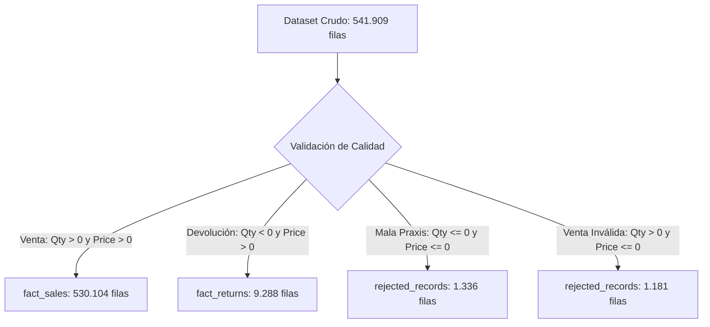

# Informe de Exploración de Fuentes y Calidad de Datos (EDA)
## Proyecto: DataMart S.A.S. — Pipeline ETL y Data Warehouse
**Autor:** Jayzir Martinez  
**Fecha de Análisis:** 2026-10-27  
**Estado:** Documentación Técnica de Evaluación (Sección 6 del Enunciado)

---

## 1. Resumen Ejecutivo

Antes de diseñar y cargar la información al repositorio analítico (Data Warehouse), se realizó una exploración exhaustiva de los datos crudos descargados desde Kaggle. Este análisis permitió identificar problemas estructurales de calidad, mala praxis contable en las fuentes originales, inconsistencias en catálogos y duplicidad entre fuentes, sirviendo como evidencia directa para cada una de las decisiones técnicas implementadas.

---

## 2. Ficha Técnica de las Fuentes de Datos

| Característica | Fuente 1: `data.csv` | Fuente 2: `online_retail_II.csv` |
| :--- | :--- | :--- |
| **Rol en el Negocio** | Volcado transaccional diario operacional | Historial extendido previo |
| **Dimensiones** | 541.909 filas × 8 columnas | 541.909 filas × 9 columnas (incluye columna `index`) |
| **Peso en Disco** | 43.47 MB | 47.25 MB |
| **Codificación de Lectura** | `ISO-8859-1` / `utf-8` | `ISO-8859-1` / `utf-8` |
| **Rango Temporal** | 2010-12-01 08:26:00 a 2011-12-09 12:50:00 | 2010-12-01 08:26:00 a 2011-12-09 12:50:00 |
| **Estructura de Columnas** | `InvoiceNo`, `StockCode`, `Description`, `Quantity`, `InvoiceDate`, `UnitPrice`, `CustomerID`, `Country` | `index`, `InvoiceNo`, `StockCode`, `Description`, `Quantity`, `InvoiceDate`, `UnitPrice`, `CustomerID`, `Country` |

---

## 3. Análisis de Valores Nulos y Completitud

```text
Columna          Tipo de Dato    Nulos Detectados    % de Nulos
----------------------------------------------------------------
InvoiceNo        VARCHAR / STR                  0         0.00%
StockCode        VARCHAR / STR                  0         0.00%
Description      VARCHAR / STR              1.454         0.27%
Quantity         INTEGER                        0         0.00%
InvoiceDate      TIMESTAMP                      0         0.00%
UnitPrice        DECIMAL                        0         0.00%
CustomerID       FLOAT / VARCHAR          135.080        24.93%
Country          VARCHAR                        0         0.00%
```

### Hallazgo Crítico — El Caso de `CustomerID`:
- **135.080 transacciones (24.93% del volumen total)** carecen de identificación de cliente.
- **Impacto Evaluativo:** Si se hubieran descartado o eliminado estos registros, el Data Warehouse habría perdido una cuarta parte del volumen operacional de la empresa y una porción millonaria de facturación.
- **Decisión Aplicada (ADR-002):** Conservar los registros asignándoles la clave canónica `'ANONYMOUS'` (`Consumidor Final / Anónimo`), permitiendo además contestar la **Pregunta de Negocio #5** sobre la comparación de hábitos entre clientes registrados y no registrados.

---

## 4. Distribución de Variables Numéricas y Rangos

### 4.1 Cantidades (`Quantity`)
- **Transacciones Positivas (Ventas):** 531.285 filas (98.04% del dataset). Rango: `[+1 .. +80.995]`.
- **Transacciones Negativas (Devoluciones/Ajustes):** 10.624 filas (1.96% del dataset). Rango: `[-80.995 .. -1]`.
- **Cantidades en Cero:** 0 filas.
- **Decisión Aplicada (ADR-008):** Segregación física estricta entre `fact_sales` (ventas con cantidad $> 0$) y `fact_returns` (devoluciones con cantidad $\le 0$).

### 4.2 Precios Unitarios (`UnitPrice`)
- **Precios Positivos Válidos:** 539.392 filas (99.54%).
- **Precios en Cero:** 2.515 filas (0.46%).
- **Precios Negativos:** 2 filas (con importes corruptos como `-11062.06`).

---

## 5. Detección de Casos de Rechazo y Auditoría (ADR-009)

Al cruzar `Quantity` y `UnitPrice` se identificaron dos anomalías contables severas en las fuentes operacionales:



1. **Mala Praxis Contable (`Quantity <= 0` Y `UnitPrice <= 0`) — 1.336 filas:**
   - **Diagnóstico:** Registros operacionales donde el personal de ventas o el sistema legado intentó anular o ajustar una transacción ingresando un precio cero o negativo sobre una cantidad negativa. Esto desvirtúa el balance financiero y no representa una devolución comercial genuina.
   - **Acción:** Se rechazan y se aíslan en la tabla `rejected_records` con motivo `'CANTIDAD_Y_PRECIO_INVALIDOS_CORRECCION_ERRONEA'`.
2. **Ventas con Precio No Positivo (`Quantity > 0` Y `UnitPrice <= 0`) — 1.181 filas:**
   - **Diagnóstico:** Transacciones de salida de mercancía sin facturación económica (muestras, errores de digitación o promociones no parametrizadas). El PDF prohíbe expresamente incluir precios $\le 0$ en ventas válidas.
   - **Acción:** Se rechazan y se registran en `rejected_records` con motivo `'PRECIO_UNITARIO_INVALIDO_LEQ_0'`.
3. **Total de Transacciones Rechazadas:** **2.517 filas** auditadas con trazabilidad completa de su payload original (`raw_record` en formato JSONB).

---

## 6. Variaciones Tipográficas en Descripciones de Producto

- **Códigos Únicos de Producto (`StockCode`):** 3.958 referencias distintas.
- **Productos con Descripciones Inconsistentes:** **645 productos (16.30% del catálogo total)** presentan entre 2 y 5 redacciones diferentes para un mismo código.
  - *Ejemplo real detectado:* Código `85123A` aparece indistintamente como:
    - `"WHITE HANGING HEART T-LIGHT HOLDER"`
    - `"white hanging heart t-light holder"`
    - `"WHITE HANGING HEART T-LIGHT HOLD"`
- **Decisión Aplicada (ADR-003):** Para cada código se calcula la **moda estadística** (la descripción más repetida normalizada en mayúsculas), asignándola como la descripción canónica en `dim_products`.

---

## 7. Solapamiento Temporal y Duplicidad entre Fuentes

- **Periodo en `data.csv`:** `2010-12-01 08:26:00` a `2011-12-09 12:50:00`.
- **Periodo en `online_retail_II.csv`:** `2010-12-01 08:26:00` a `2011-12-09 12:50:00`.
- **Hallazgo:** Ambos archivos contienen exactamente el mismo periodo temporal de órdenes con 554.495 registros duplicados/solapados.
- **Riesgo:** Si un pipeline concatenara ambas fuentes sin deduplicar, las ventas e ingresos del negocio se duplicarían artificialmente a más de 1.08 millones de transacciones.
- **Decisión Aplicada (ADR-004):** Se genera una **clave natural compuesta** `[invoice_no, stock_code, invoice_timestamp_utc, quantity]` y se otorga prioridad estricta al volcado diario (`data.csv`), descartando los duplicados redundantes de forma determinista.

---

## 8. Distribución Geográfica y Monedas

### Top 5 Países por Frecuencia de Transacciones:
1. **United Kingdom:** 495.478 transacciones (91.43%) — Moneda: GBP (£).
2. **Germany:** 9.495 transacciones (1.75%) — Moneda: EUR (€).
3. **France:** 8.557 transacciones (1.58%) — Moneda: EUR (€).
4. **EIRE (Irlanda):** 8.196 transacciones (1.51%) — Moneda: EUR (€).
5. **Spain:** 2.533 transacciones (0.47%) — Moneda: EUR (€).

- **Diagnóstico:** Los precios unitarios en las fuentes están expresados en libras esterlinas (GBP) y euros (EUR). Si se calcula el ticket promedio o las ventas netas sin conversión, se comparan valores con poder adquisitivo y escalas dispares.
- **Decisión Aplicada (ADR-0014):** Se implementó la capa de normalización de divisas que consulta **Frankfurter API** (`https://api.frankfurter.dev/v1/latest?base=USD`) para convertir todos los importes a **USD**, manteniendo además el registro de la moneda y precio original para trazabilidad contable.

---

## 9. Matriz Consolidada de Acciones de Calidad de Datos

| Problema Identificado en los Datos | Tipo de Acción | Regla / Tratamiento Técnico | Justificación de Negocio | Decisión Asociada |
| :--- | :---: | :--- | :--- | :---: |
| **`CustomerID` nulo en 24.9% de filas** | Corregir | Asignar valor canónico `'ANONYMOUS'` | No perder ventas reales y responder pregunta #5 | **ADR-0002** |
| **Variación de nombres para un mismo código** | Corregir | Calcular la moda estadística (frecuencia máxima) | Unificar catálogo y evitar duplicidad en reportes | **ADR-0003** |
| **Duplicados exactos entre fuentes** | Filtrar | Deduplicación por clave compuesta con prioridad a `data.csv` | Evitar doble conteo financiero de ventas | **ADR-004** |
| **Venta con `UnitPrice <= 0` (1.181 filas)** | Rechazar | Canalizar a `rejected_records` con motivo | Cumplimiento de regla obligatoria del PDF | **ADR-009** |
| **Mala praxis `Qty <= 0` Y `Price <= 0` (1.336 filas)** | Rechazar | Canalizar a `rejected_records` con motivo | Corregir distorsión contable de origen | **ADR-009** |
| **Devoluciones con cantidad $< 0$** | Segregar | Insertar en `fact_returns` con valor absoluto | Separar devoluciones para cálculo de ventas netas | **ADR-008** |
| **Monedas múltiples (GBP, EUR, etc.)** | Estandarizar | Conversión dinámica a USD vía Frankfurter API | Comparar ticket promedio entre países (Pregunta #4) | **ADR-0014** |
| **Fechas sin zona horaria explícita** | Estandarizar | Conversión y estandarización obligatoria a UTC | Comparabilidad temporal uniforme | Sección 5 PDF |
